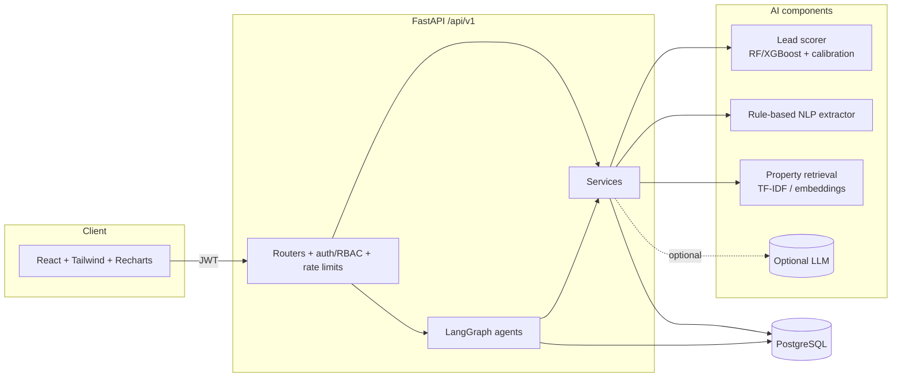
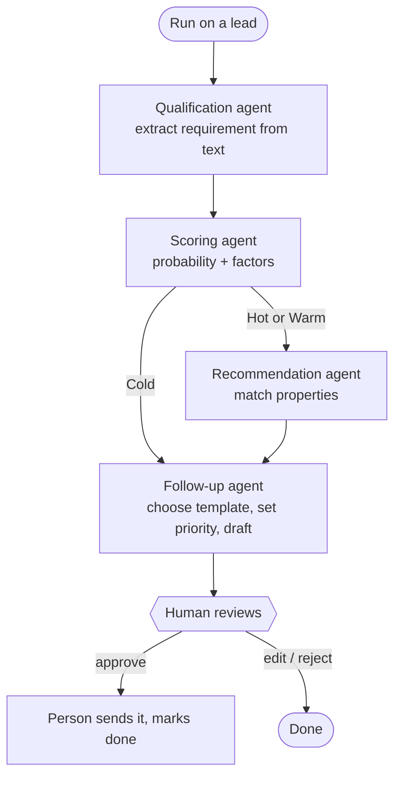

# Architecture

Layers: **routers** (HTTP only) → **services** (business logic, no HTTP) → **models** (SQLAlchemy).
Schemas (pydantic v2) validate every request/response. Cross-cutting concerns — settings, security, rate
limiting, error handling, request IDs — live in `app/core`.

## Which technique does what

| Capability | Technique | Why |
|---|---|---|
| Lead scoring | Traditional ML (tabular) | Small structured data; calibrated, explainable, cheap |
| Requirement extraction | Rules/regex NLP; LLM only fills gaps | Deterministic, testable, works offline; output validated |
| Property recommendation | Hard filters + weighted scoring | Budget/location are constraints, not "vibes" |
| Chatbot | RAG: retrieve listings, then answer | Replies grounded in real listings; id citations checked |
| Follow-up drafts | Templates, optionally LLM-personalised | Predictable tone; facts checked against the lead record |
| Orchestration | LangGraph, deterministic graph | Auditable, no free-running tool loop |
| Forecast / insights | SQL aggregates + simple trend | Transparent arithmetic; LLM may only narrate |

## Agent workflow

A separate read-only *sales-intelligence* graph produces channel and trend insights.

**Write boundary (enforced by tests):** agents may append requirements, predictions and logs and create
**draft** follow-ups. They never change lead status, assignment or contact details, and never send
messages. Each node is timed and written to `agent_logs`; a node failure is recorded and the run
continues with what it has.

## Follow-up state machine

`draft → approved → sent/completed` or `draft → rejected`. Editing an approved AI draft returns it to
`draft`. Only a person can approve or complete.

## Data model

Nine tables — see [`schema.sql`](schema.sql): `users`, `leads`, `properties`, `customer_requirements`,
`lead_interactions`, `follow_ups`, `predictions`, `marketing_campaigns`, `agent_logs`. Requirements and
predictions are append-only history; `leads` caches the latest score for fast filtering.

## Security model

JWT bearer auth, bcrypt hashes, roles `admin` / `manager` / `agent`. Agents see only their own and
unassigned leads (others return 404, not 403, so existence isn't revealed). Rate limits on global, login
and chat endpoints. Production refuses to start with a weak `SECRET_KEY`.
